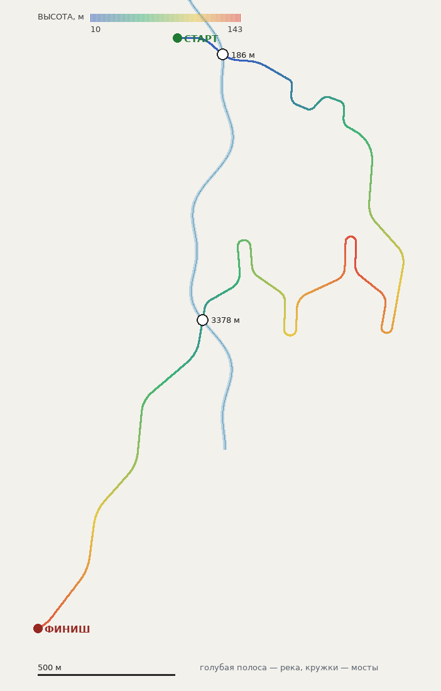

# ЧЁРНАЯ ДОЛИНА • АНГЛИЯ

Выбор: меню трасс → **ЧЁРНАЯ ДОЛИНА · АНГЛИЯ**. Сложность 5/5,
ориентир времени — 5:18. Трасса фиксированная (не процедурная), поэтому
рекорды воспроизводимы и привязаны к `id`, а не к сиду генератора.

- Длина: **4706 м** (лимит 4800 м — дальше включается автопоток мира на 5 км,
  а этап рассчитан на плотную ночную геометрию в один заход).
- Высоты: **10 → 143 м** (перепад 133 м), максимальный уклон **8,5 %**.
- Профиль не монотонный: разгон → набор высоты на гребень (143 м) → долгий
  спуск в долину реки (низшая точка трассы после старта — 43 м на большом
  мосту) → финишный подъём. Спуск и подъём настоящие: 100 м вниз и 100 м
  вверх после гребня.
- 327 контрольных точек осевой линии, средний шаг ~14 м.
- Ночь: `night_mode`, туман 24…130 м, 5 уровней цвета в ретро-экране.
- 8 участков покрытия (гравий ↔ асфальт), 40…220 м на переход.
- Два моста через реку, 4 типа новых британских пропсов.

| м | Покрытие | Полуширина, м | Сцепление | Что происходит |
|---:|---|---:|---:|---|
| 0 | Гравий | 4,1 | 1,00 | старт на размокшей обочине у переправы |
| 560 | Асфальт | 3,8 | 1,28 | полка над водой, узко и быстро |
| 1150 | Гравий | 3,4 | 0,90 | спуск в лес, слепые гребни |
| 1900 | Асфальт | 3,6 | 1,20 | шпильки на набор высоты к гребню |
| 2650 | Гравий | 3,3 | 0,86 | долгий спуск с гребня, колея |
| 3250 | Асфальт | 3,9 | 1,30 | выход из спуска к большому мосту |
| 3560 | Гравий | 3,5 | 0,92 | после моста, подъём из долины |
| 4100 | Асфальт | 3,7 | 1,22 | финишный подъём к седловине |



## Река и мосты

Река — не декорация, а часть рельефа: она прорезает землю, у неё есть
уровень воды, берега и два пролёта над ней.

- Осевая линия: `data/tracks/stage_england_river.tres` (`Curve3D`,
  z ∈ [−140, 1500] м, `x = 120 + 74·sin(z/168) + 26·sin(z/61 + 1.3)`).
- Уровень воды **5,6 … 38,2 м**: вода выводится из рельефа вдоль русла, а не
  из формулы «дуга между двумя настилами».
- Под настилами — плоское корыто на расчётном просвете (30–34 м ровно), иначе
  прореженные контрольные точки кривой всплывали на полметра.
- Мосты: **186 м** (малый, дубовый настил, вода на 2,8 м ниже полотна) и
  **3378 м** (большой, две арки и три опоры, вода на 4,6 м ниже).
- Оба пересечения — под 47° к оси русла: мост «в косую», как в жизни.
- Вне мостов дорога не подходит к оси реки ближе **24 м** (фактически 35 м),
  поэтому насыпь нигде не работает плотиной.

Порядок сборки рельефа важен и не случаен:

1. базовый рельеф + сведение с полотном,
2. кювет,
3. `_limit_terrain_slopes()` — ограничитель склонов,
4. **только теперь** русло (`_apply_river`), иначе ограничитель «замывает»
   канал обратно и вода стоит на насыпи,
5. `_ground_grid` копируется уже с руслом — по нему садятся камни, столбики
   и внешняя кромка полотна.

Русло прорезается насквозь только внутри `open_radius` моста; вне пролёта
оно плавно «уходит под насыпь» в полосе `road_keep_zone`. Поэтому вода не
течёт поперёк дороги и не появляется там, где моста нет.

Профиль русла: дно у оси, на кромке воды дно поднимается ровно до уровня
воды (это береговая линия), дальше откос сливается с естественным рельефом.
Без этого зеркало воды висело бы над землёй, а между водой и берегом зияла
щель.

### Почему вода была «треугольной»

Причина в региональном рельефе: `road_network._build_regional()` строит его
**из высоты дороги** (широкое размытие высоты ближайшей точки трассы). Значит
профиль дороги — это и есть профиль местности. Пока трасса монотонно лезла
10 → 180 м, северная переправа (3378 м) оказывалась на 135-метровом плато:
река, пересекающая трассу именно там, шла по вершине «горы», зеркало висело
над землёй на десятки метров и рисовало длинные треугольные простыни — а
камень моста стоял в мелкой канаве на вершине.

Что сделано:

1. Профиль трассы перестроен (`heights_for()` теперь интегрирует **уклон**, а
   не задаёт высоты точками): гребень в середине, спуск в долину, вторая
   переправа — в низкой долине (43 м), финишный подъём. Уклон ровно нулевой
   на подходах к настилам, поэтому жёсткий настил ложится на полотно без
   ступеньки на торце.
2. Вода считается **по рельефу** (`river_levels()`): релаксация «сглаживание +
   срез под землю» даёт самую высокую гладкую линию, которая нигде не
   поднимается выше земли, плюс плоское корыто под настилами.
3. В движке добавлен страховочный `_clamp_river_water()`: перед постройкой
   меша каждый сэмпл русла прижимается к `_road_shoulder_height()`, а три
   прохода сглаживания умеют только опускать воду.
4. Кромка воды в `build_water_mesh()` больше не съезжает по склону: отжатие
   от земли ограничено 0,5 м, иначе на берегу появлялись узкие треугольные
   лоскуты.

## Данные и авторинг

| Файл | Что внутри |
| --- | --- |
| `data/tracks/stage_england_route.tres` | `Curve3D` осевой линии (Bezier, 319 точек) |
| `data/tracks/stage_england_river.tres` | `Curve3D` оси русла, Y — уровень воды |
| `data/tracks/stage_england.tres` | `RallyTrackConfig`: участки, ночной вид, `RallyRiverConfig`, два `RallyBridgePlacement` |
| `scenes/rally_stage_england.tscn` | сцена этапа: своя `Route`, `track_override = stage_england.tres` |
| `scripts/data/rally_river_config.gd` | параметры реки (ширина, глубина, берег, вода, шейдер) |
| `scripts/data/rally_bridge_placement.gd` | параметры моста (метраж, пропс, радиус пролёта, расширение русла) |
| `scripts/track/river_network.gd` | чистая математика: поиск русла, прорезание, сетка воды |
| `shaders/river_water.gdshader` | вода PS1: рябь, пена у берега, блики фар |
| `scenes/props/{bridge_small,bridge_large,river_bank_rock,dry_stone_wall}.tscn` | британские пропсы |

Пересобрать всё одной командой:

```bash
python3 tools/author_england_stage.py
python3 tools/plot_stage_plan.py data/tracks/stage_england.tres docs/england_stage_plan.png
```

`tools/plot_stage_plan.py` рисует карту «вид сверху» по тем же ресурсам, что
читает игра: план удобно проверять глазами, не запуская Godot.

Инструмент уважает правки из редактора: `uid://` ресурсов читается из
существующих файлов (Godot при пересохранении выдаёт свои), а сцена этапа
собирается сама из себя — цвета земли, свет и добавленные вручную узлы
переживают перегенерацию. Шаблоном `scenes/rally_stage.tscn` она пользуется
только если файла ещё нет.

Инструмент сам проверяет результат и падает, если что-то не сходится:
длину (≤ 4800 м), уклон (≤ 9 %), число пересечений русла (ровно 2),
угол к реке (≥ 40°), зазор до оси вне мостов (≥ 24 м), просвет под настилом
(≥ 2,5 м), профиль воды (нет участков круче 25 % и нет воды выше земли) и то,
что большой мост стоит выше по течению малого. После правки любых констант
его достаточно запустить снова — он перезапишет все четыре ресурса, включая
сцену этапа.

## Проверки

```bash
python3 tools/check_project.py                 # ссылки в .tres/.tscn
python3 tools/check_road_collision.py          # нет ли коллизии над лентой
python3 tests/test_england_stage.py            # маршрут, река, мосты (без Godot)
godot --headless --path . --script res://tests/stage_smoke.gd
```

`tools/check_road_collision.py` ловит «невидимые кочки»: разрежённая коллизия
рельефа проходит над лентой дороги там, где видимый меш вырезан дырой. На
этом этапе превышение было 29 % длины и до 1,74 м — машину подбрасывало на
ровном месте. С `--coarse` проверка воспроизводит старое поведение.

`tests/test_england_stage.py` не доверяет инструменту, а перечитывает готовые
ресурсы: считает длину и уклоны по всей кривой, находит пересечения русла по
знаку `x − river_x(z)`, сверяет метраж мостов с этими пересечениями, проверяет
просвет под настилом и зазор до реки вне мостов.

## Пропсы

Текстуры — `tools/make_uk_prop_textures.py`, сцены — `tools/make_uk_props.py`.
Четыре пропса зарегистрированы в `data/stage/default_prop_library.tres` с
весом **0.0**: генератор обстановки их не ставит, только мосты и берега реки.

Ширина настила подобрана под ленту полотна: полотно с обочиной и внешней
кромкой занимает ±6,6 м, поэтому малый мост шириной 14,2 м, большой — 15,8 м,
а парапеты стоят **снаружи** ленты (±6,98 и ±7,75 м). Иначе парапет прорастал
бы сквозь гравий. Настил лежит на 0,07 м ниже полотна, а внешняя кромка ленты
на мосту опускается ещё на 0,12 м — она прячется внутри настила, и дорога
выглядит как гравий по дереву.

Коллизия моста проверена отдельно, потому что именно она делала переправу
непроезжей:

- в мосте есть `StaticBody3D` «Collision» (слой 2) с коробками настила, пят,
  опор и парапетов;
- парапеты в коллизии стояли на ±6,98 м при внешней кромке ленты 6,6 м —
  машина цепляла их краем колеи; теперь коллизия парапета вынесена за ленту
  (±7,25 / ±7,9 м) и сужена;
- пятка опоры выступала на 3 см **выше** полотна — на торце моста получалась
  невидимая ступенька; теперь низ опоры ниже полотна;
- добавлена сплошная плита настила под лентой: даже если лента над
  прорезанным руслом где-то провиснет, пролёт остаётся проезжим;
- на пролётах больше не ставятся отбойники и угловая изгородь
  (`_bridge_open_at()` в `_spawn_guardrails()` / `_dressing_corner_fence()`):
  их высота считалась по вырезанному руслу, и столбик вырастал поперёк
  настила.

## Что осталось непроверенным

Godot в этой среде нет, поэтому в движке этап ещё не запускался. Проверено
только численно и по ссылкам ресурсов: геометрия, уклоны, пересечения,
просветы, отсутствие висячих ссылок. Первый запуск стоит смотреть глазами:
берега и вода на повороте русла (стыки сетки воды), посадку камней на склон
берега, тени парапетов на настиле и то, как выглядит ночью пена у берега.
